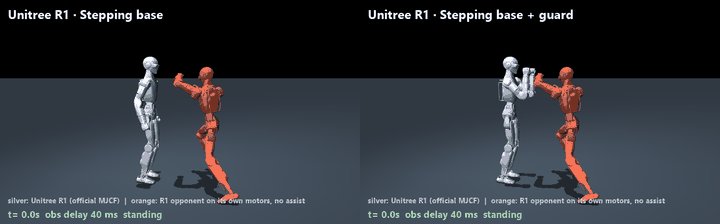
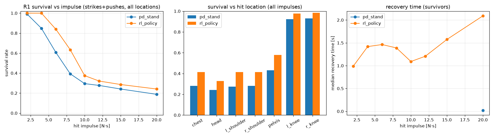
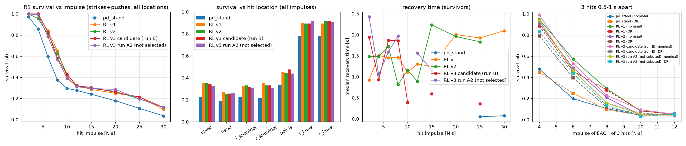

# r1-sparring-gym

MuJoCo simulation and RL for turning a **Unitree R1** into a near-real-time sparring / grappling partner (built for Zoon Robotics' R1 EDU).



Left: stiff PD stand (baseline). Right: the RL balance policy. Both face the same R1 opponent (KungFuAthleteBot clip `kfab_202`, held out of training) and the same scripted hits. In this demo PD falls at 9.1 s and RL at 11.0 s. The demo is not hand-picked; see "Demo robustness" below for 8 re-sampled variants. Full video: [`media/demo.mp4`](media/demo.mp4).

## Plan
1. **Sim.** R1 model on the official Unitree MJCF, a fight-motion opponent, procedural hits, sensor delay and noise. Done.
2. **Hit-robust balance policy.** Residual PPO on top of a PD stand, exported to ONNX. Done (v2 in this README).
3. **Perception + block / counter / clinch** from the head camera. Roadmap: [ROADMAP.md](ROADMAP.md).
4. **Safety + sim-to-real** on the R1 EDU (system ID, e-stop, padded mode). Roadmap: [ROADMAP.md](ROADMAP.md).

## What's in the repo
| path | what |
|---|---|
| `r1gym/model.py` | R1 from `unitree_rl_mjlab` r1.xml (24 actuated DoF, 28.93 kg), PD servos, torque caps, opponent attachment with compliant (padded) contact |
| `r1gym/opponent.py` | kinematic sparring partner: a second R1 replaying KungFuAthleteBot G1 clips retargeted to R1 by keypoint IK |
| `r1gym/perturb.py` | strikes / pushes / grabs by impulse, body and direction; peak force capped at 400 N |
| `r1gym/env.py` | env (78-dim obs, 24-dim residual action), 0–40 ms obs delay, noise, optional opponent in training, thread/process batching |
| `r1gym/policy.py` | PD baseline, torch policy, ONNX policy |
| `scripts/` | `verify_r1.py`, `train.py`, `evaluate.py`, `demo_check.py`, `demo.py`, `export_onnx.py` |
| `configs/r1_assumptions.yaml` | every parameter not taken from Unitree (armature, foot friction, PD gains) |
| `results/policy/` | v2 policy (`policy.pt`, `policy.onnx`, `train_log.json`, `latency.json`); `results/policy_v1/` = v1 |
| `results/eval/`, `results/eval_v1/` | hit eval for v2 / v1 (`summary.json`, `survival.png`) |
| `results/policy_v3_candidate/`, `results/eval_v3/` | v3 attempt (DR + recovery reward + multi-hit curriculum): **not adopted**, see below |
| `results/demo_check.json` | demo fall times + 8 variants |
| `docs/MODEL_AUDIT.md`, `docs/GPU.md` | model audit; GPU-batched (mjlab / MuJoCo Warp) path |

## Quickstart
```bash
pip install -e .[dev]
python scripts/verify_r1.py                  # R1 spec checks -> results/r1_verification.json
python scripts/train.py --envs 256 --horizon 32 --workers 10 --minutes 30 --imp0 6 --opp_prob 0.5 \
    --init results/policy_v1/policy.pt --out results/policy_new   # v2 recipe, stage 1
python scripts/evaluate.py --out results/eval_v3                 # PD + v1 + v2 + v3 candidate: single hits to 30 N·s, 3-hit survival (nominal + DR)
python scripts/demo_check.py --policy v2=results/policy/policy.pt v3=results/policy_v3_candidate/policy.pt   # demo fall times + 8 variants
MUJOCO_GL=egl python scripts/demo.py   # PD vs v2; e.g. --right "RL v3=results/policy_v3_candidate/policy.pt"
python scripts/export_onnx.py --ckpt results/policy/policy.pt    # -> results/policy/policy.onnx + latency
pytest -q
```

## Results (v2 vs v1 vs PD)
Eval: 896 single-hit episodes per controller (strike/push × 7 locations × 8 impulses × 4 directions × 2 reps), 0–40 ms obs delay, sensor noise.

| | PD stand | RL v1 | **RL v2** |
|---|---|---|---|
| Overall fall rate | 0.52 | 0.413 | **0.411** |
| Fall rate @ 4 / 6 / 8 / 10 N·s | 0.15 / 0.39 / 0.61 / 0.71 | 0.00 / 0.16 / 0.37 / 0.63 | 0.00 / 0.19 / 0.39 / 0.57 |
| Largest impulse with ≥50% survival | 6 N·s | 8 N·s | 8 N·s |
| Fall rate chest / head / pelvis | 0.72 / 0.76 / 0.57 | 0.59 / 0.67 / 0.42 | 0.56 / 0.66 / 0.43 |
| Demo (`kfab_202`) fall time | 9.1 s | 6.1 s | **11.0 s** |
| Demo variants: mean time to fall (8 runs, 12 s clip) | 9.16 s | 7.34 s | **9.74 s** |
| Demo variants where RL outlasts PD | – | 2 / 8 | **6 / 8** |

On single hits, v2 is about the same as v1 (0.411 vs 0.413 is within noise). It is slightly better at 10 N·s and slightly worse at 6–8 N·s. The real gain is with an opponent in contact range. v1 never saw one in training and usually fell about 1.5 s after the 4.6 s head strike plus the opponent's knee contact. v2 trains with an opponent in 50–70% of episodes.

**Demo robustness.** Each of the 8 variants re-samples hit durations, the obs delay (0–2 steps) and the opponent distance (0.80–0.95 m). RL v2 fall times are 6.28, 11.0, 10.8, 10.84, 6.18, 10.8, 11.04 and 10.96 s; PD falls at 9.0–9.36 s in all 8. Neither controller survives the 8 N·s push at 9.5 s every time. The candidate was chosen on eval fall rate plus mean variant survival across 5 trained candidates (3 fine-tunes without the opponent, 2 with it; numbers in the PR). It was not chosen on the main demo alone.



**Opponent force.** The opponent is kinematic (infinite mass), so its contacts are made compliant like a padded surface (`OPP_SOLREF`/`OPP_SOLIMP` in `r1gym/model.py`). Peak contact force in the demo is 315 N (it was 630 N before). Scripted hit peak force is capped at 400 N, with the impulse preserved.

## v3 attempt: harder hits, recovery reward, domain randomisation (not adopted)
Feedback on v1 was that it fell over too easily. v3 tried to fix that, starting from v2:
- **Harder, denser hits:** 3–8 hits per 10 s episode, 0.5–1.8 s apart (run B: 1.0–2.5 s). The curriculum grows the impulse whenever the episode fall rate is under 0.35, up to a cap of 40 N·s.
- **Recovery reward** (`--reward v3`): no penalty for leaving the stance, a weak leg-velocity penalty, and a strong upright/height term. The residual limit was already ±1 rad (clip ±4 × 0.25), so it did not need loosening.
- **Domain randomisation** (`--dr 1`), sampled per episode:
  - link mass ×0.85–1.15, plus −0.5…+2 kg on the torso
  - pelvis/torso COM ±2.5 cm
  - foot friction 0.5–1.25
  - per-joint kp/kd ×0.8–1.2 and torque cap ×0.8–1.05
  - armature ×0.5–1.5
  - 0–20 ms command latency (on top of the 0–40 ms observation delay)
- **Opponent:** present in 50% of episodes.

Two runs on one RTX 4090 pod:
- **Run B:** 80 min, 13M steps.
- **Run A:** 33 min, then it crashed (OOM from per-env model copies, since fixed: DR now swaps parameters into a shared model). It was resumed as A2 for 55 min, 10.5M steps.

**The curriculum stalled at a 7–9 N·s max impulse in both runs.** Under DR with dense hits, the episode fall rate stayed at 0.4–0.6, so the impulse never grew toward sparring levels.

New eval (`scripts/evaluate.py`): 1120 single hits per controller up to 30 N·s, plus 96 three-hit sequences per impulse (random kind, location and direction, 0.5–1 s apart), on the nominal model and under DR.

| | PD | RL v1 | **RL v2 (current)** | RL v3 cand. (run B) | RL v3 run A2 |
|---|---|---|---|---|---|
| Single-hit fall rate (1120, 2–30 N·s) | 0.606 | 0.495 | **0.498** | 0.495 | 0.505 |
| Fall rate @ 6 / 8 / 10 / 15 / 20 / 30 N·s | .40/.63/.71/.76/.82/.96 | .16/.35/.60/.71/.75/.90 | .19/.38/.57/.71/.73/.88 | .17/.42/.57/.70/.74/.88 | .21/.43/.61/.71/.71/.88 |
| 3-hit survival @ 4 / 6 / 8 / 10 N·s (nominal) | .48/.20/.10/.04 | .95/.57/.29/.08 | .91/.49/.21/.04 | .99/.53/.23/.09 | .94/.47/.16/.05 |
| 3-hit survival @ 4 / 6 / 8 / 10 N·s (DR) | .45/.25/.09/.04 | .89/.46/.28/.08 | .79/.40/.12/.05 | .93/.47/.16/.06 | .83/.44/.14/.03 |
| Demo fall time | 9.1 s | 6.1 s | **11.0 s** | 10.8 s | 9.2 s |
| Demo variants: mean survival (12 s = survived) | 9.16 s | 7.34 s | 9.74 s | **11.05 s** | 10.34 s |
| Demo variants survived the full 12 s | 0/8 | 0/8 | 0/8 | 0/8 | 4/8 |

**Verdict: v3 is not a clear robustness improvement, so v2 stays the shipped policy** (`results/policy/`, demo media unchanged).
- **Where the v3 candidate is better:**
  - It is more consistent in the demo variants. All 8 fall at 10.8–11.7 s, versus two early 6.2 s falls for v2.
  - It does a little better on 3-hit sequences, mostly under DR.
- **Where it is not better:**
  - Single-hit fall rates are unchanged, and slightly worse at 8 N·s.
  - Survival above ~10 N·s is still poor for every controller, and v1 is as good as anything on multiple hits.
- **Bottom line:** none of these controllers survives sparring-level hits. Every one falls to 15–30 N·s hits more than 70% of the time.
- **What would likely help next:**
  - a curriculum that does not gate on the fall rate under full DR (e.g. ramp DR in after the impulse grows)
  - a stepping-capable base controller (Unitree's walking policy) instead of a residual on a stiff stand
  - much more compute



## Compute and cost
- **v1:** PPO, 60 min, 65.8M env steps, one RunPod RTX 4090 pod (training is CPU MuJoCo on the pod's ~10-vCPU quota; the GPU is barely used).
- **v2:** warm-started from v1 on one RunPod RTX 4090 pod ($0.89/h), with runs in parallel:
  - Stage 1: 27 min, 4.2M steps, opponent in 50% of episodes.
  - Stage 2: 25 min, 3.9M steps, opponent in 70%, starting impulse 7 N·s.
  - The pod was up about 1.9 h in total, about $1.7, including 3 discarded fine-tunes without the opponent and a few crashed launches (the pod has a 31 GB memory limit).
- **v3 attempt:** one RTX 4090 pod for ~2.3 h (~$2), two runs in parallel (8 workers each).
- **ONNX:** 227 KB, p50 8.4 µs / p99 17 µs at batch 1 on one x86 thread; max error vs torch 2.4e-7.

## Limitations
- Proprioceptive only. Neither upstream R1 MJCF has a head camera, so nothing here sees the opponent (that is phase 3).
- Armature, foot friction and PD gains are assumptions, not identified on hardware (`docs/MODEL_AUDIT.md`). Nothing has been run on a real R1.
- The single-hit eval has no grabs and no opponent contact. The demo variants cover those, but only 8 runs on one held-out clip.
- The policy mostly absorbs hits standing in place. The v3 recovery reward allows stepping, but no reliable stepping emerged. It doesn't block or counter.
- Small training budget (about 74M steps total) on CPU MuJoCo. The GPU path in `docs/GPU.md` isn't benchmarked here.

## Credits
See [CREDITS.md](CREDITS.md): Unitree R1 MJCF (unitree_rl_mjlab, Apache-2.0), KungFuAthleteBot motions, MuJoCo, mjlab.
