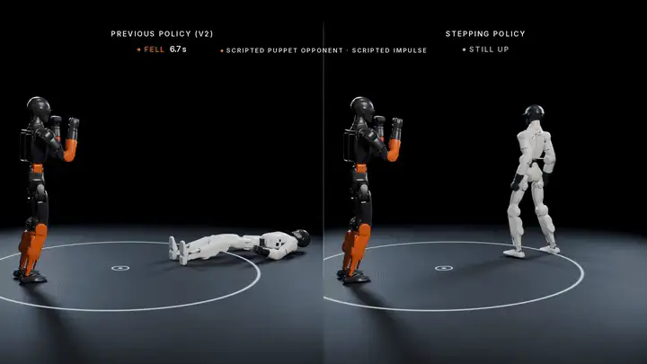
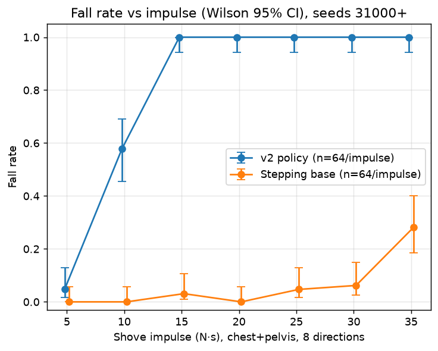

# r1-sparring-gym

**Teaching a simulated Unitree R1 humanoid to take hits and keep its feet, as a step toward a near-real-time sparring partner.**

[](media/showcase.mp4)

*60 s cut rendered in Blender from recorded simulation. First, one held-out bout run once with each controller on identical physics and hits: the rigid PD stance (left) falls, the footwork policy (right) steps and stays up; shove shots are scripted and tagged as such on screen. Then an unscripted segment: a tracker opponent drives its own motors with no scripted hits, and the footwork policy takes 18 steps with no falls. Every number on screen comes from the results files. [Full video](media/showcase.mp4) · [GIF](media/showcase_loop.gif) · [poster](media/showcase_poster.png) · [pipeline](showcase/README.md)*

> **Simulation only.** Everything here runs in MuJoCo. Nothing has run on a real R1 yet; that is the next phase (see [Roadmap](#roadmap)).

## Key results

Held-out test clips, hard tier: 20 s bouts, an opponent R1 0.40–0.55 m away stepping in, six 8–14 N·s strikes/pushes from any direction, randomised robot physics. 128 bouts per controller, same episodes for every controller.

| controller | survives the bout | up *and* within 1 m of start | single-hit fall rate (2–30 N·s, 1120 hits) |
|---|---|---|---|
| Rigid PD stand | 0.0% | 0.0% | 60.6% |
| RL v2 (residual on a stiff stand) | 0.0% | 0.0% | 49.9% |
| **Footwork policy, arms down** | **90.6%** [84–95] | **72.7%** | **3.0%** |
| **Footwork policy + guard** | **99.2%** [96–100] (127/128) | **81.2%** | **2.1%** |

95% CIs in brackets. Full tables, paired differences and every caveat: [docs/RESULTS.md](docs/RESULTS.md).

**Push fall-rate curve.** One shove per episode to the chest or pelvis from 8 directions, n=64 per impulse, seeds 31000+ (outside every val/test range).



| impulse (N·s) | 5 | 10 | 15 | 20 | 25 | 30 | 35 |
|---|---|---|---|---|---|---|---|
| RL v2 fall rate | 4.7% | 57.8% | 100% | 100% | 100% | 100% | 100% |
| Footwork policy (arms down) | 0% | 0% | 3.1% | 0% | 4.7% | 6.2% | 28.1% |

Data: [`results/push_curve/baseline_n64.json`](results/push_curve/baseline_n64.json).

## What's inside

- **A physical opponent.** A second R1 on its own motors, driven by a motion-tracking policy performing cleaned kung-fu fight clips, steered to stay in front and face our robot. No invisible forces hold it up. ([`r1gym/opponent.py`](r1gym/opponent.py))
- **Footwork balance policies.** Stepping controllers trained on GPU in mjlab from Unitree's own R1 velocity task, fine-tuned for footwork, with a hold-your-spot outer loop; one arms-down, one holding a boxer's guard. ([`gpu/`](gpu/README.md))
- **Contact on the visible shell.** The robots collide on their convex-hull meshes rather than Unitree's thinner capsules, so strikes don't pass through each other.
- **Head camera (sim).** A render twin draws the R1's head-camera view with realistic latency and dropped frames; the robot turns toward the opponent using only that feed. ([docs/HEAD_CAMERA.md](docs/HEAD_CAMERA.md))
- **Evaluation you can audit.** Preregistered rules, held-out seeds, paired comparisons with bootstrap CIs, and failed experiments kept in the record (below).


*Raw eval view: our R1 (silver) running both shipped policies against the opponent R1 (orange). Yellow spheres are real contacts (size ∝ force); orange arrows are scripted pushes. Reproduce with `python scripts/demo.py`.*

## Quickstart

Python ≥ 3.10, CPU only.

```bash
git clone https://github.com/dundysm/r1-sparring-gym && cd r1-sparring-gym
pip install -e '.[dev]'
pytest -q                                   # test suite
MUJOCO_GL=egl python scripts/demo.py        # renders the side-by-side demo clip (drop MUJOCO_GL on a desktop)
python scripts/eval_opponent.py --help      # headline eval: --tier hard|standard, --split val|test
python scripts/evaluate.py --help           # single-hit and multi-hit sweeps
```

The exact commands that produced every stored result are in [docs/RESULTS.md#quickstart](docs/RESULTS.md#quickstart).

## Repo map

| path | what |
|---|---|
| `r1gym/` | the sim: R1 model, env, opponent, hits, policies, perception |
| `scripts/` | evals, demos, A/B checks, table generators |
| `gpu/` | mjlab training tasks and how to reproduce them on a rented GPU |
| `results/` | shipped policies (ONNX + checkpoints) and every eval's raw and summary JSON |
| `showcase/` | Blender pipeline for the cinematic video |
| `media/` | videos, GIFs and figures |
| `docs/` | full results, model audit, head camera, aimed opponent, deploy contract, M2 notes |
| `tests/` | pytest suite |

## How evaluation works

- **Splits:** opponent clips are split train / val / test. Settings and candidates are chosen on validation only; test is run once, after the choice.
- **Preregistered gates:** pass/fail rules and acceptance thresholds are written down (and hashed where it matters) before a run, then reported as-is.
- **Paired comparisons:** every controller faces identical episodes, so differences come with paired bootstrap 95% CIs.
- **Independent verification:** larger milestones get a separate build report and verifier report ([docs/m2v2/build/](docs/m2v2/build)).
- **Honest failures, kept in the record:**
  - Residual RL on a stiff stand (v1–v3) never learned to survive sparring-level hits; replaced by stepping.
  - A turning fine-tune (stage 4) missed its preregistered turn-rate bar; **not shipped**.
  - The aimed opponent (M1) lands more head strikes but falls too often in the hard tier; **not the default**.
  - Whole-body sparring training (M2 v2) is **paused**; status in [docs/m2v2/STATUS.md](docs/m2v2/STATUS.md).

## Roadmap

1. Sim, physical opponent, hit-robust footwork balance. **Done (sim).**
2. Perception + block / counter / clinch from the head camera. Camera plumbing done; learned perception next.
3. **Sim-to-real** on the R1 EDU: system ID, e-stop, padded mode, free-standing push tests, then a dummy opponent.

Details: [ROADMAP.md](ROADMAP.md). Known limitations: [docs/RESULTS.md#limitations](docs/RESULTS.md#limitations).

## License and citation

Code is Apache-2.0 ([LICENSE](LICENSE)). Third-party assets (Unitree R1 MJCF, KungFuAthleteBot motions, MuJoCo, mjlab) keep their own licenses: [CREDITS.md](CREDITS.md).

```bibtex
@software{pasupuleti_r1_sparring_gym_2026,
  author = {Pasupuleti, Dundy},
  title  = {r1-sparring-gym: hit-robust footwork for a simulated Unitree R1},
  year   = {2026},
  url    = {https://github.com/dundysm/r1-sparring-gym}
}
```

---

Built by **Dundy Pasupuleti** ([@dundysm](https://github.com/dundysm)).
