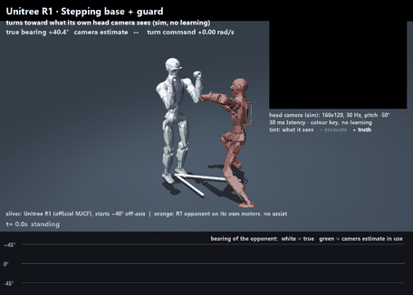

# r1-sparring-gym

MuJoCo simulation and RL for turning a **Unitree R1** into a sparring partner that can take hits from a real opponent and stay up.


**Silver:** our R1 running the two shipped policies, stepping balance controllers trained on GPU from Unitree's own R1 task: arms down (left) and the same base holding a boxer's guard (right). **Orange:** the opponent, a second R1 **on its own motors**. A motion-tracking policy performs cleaned KungFuAthleteBot fight clips (here `kfab_201`, with its idle stretches and posing cut), and the sim steers it to stay in front of our R1 and face it. No invisible forces hold it up. **Yellow spheres** are real contacts between the two robots (size ∝ force); **orange arrows** are scripted pushes from the side and behind. Full video: [`media/demo.mp4`](media/demo.mp4). Reproduce: `python scripts/demo.py`.

**Status (all simulation, held-out test clips):**
- **Hard tier** (20 s bouts; the opponent 0.40–0.55 m away and stepping in; six 8–14 N·s strikes and pushes from any direction; randomised robot physics): the arms-down base survives **89.1%** of bouts (95% CI 82.5%–93.4%) and the guard 92.2%. PD and the residual policies survive 0%.
- **Standard tier** (10 s, two side/back pushes): 100% (arms down) and 99.4% (guard) on test; 98.8% and 100% on validation.
- **Single hits:** fall rate 0.057 (arms down) and 0.044 (guard) over 2–30 N·s, vs 0.494–0.499 for the residual policies (v1–v3). They stay up at least half the time up to **35 N·s** and 30 N·s.
- **The opponent** stays upright in **46/48** 10 s runs on its own, and in bouts on train + val clips (`selection.json`) it stays a median 4° off straight in front of our R1.
- **Contact:** the robots collide on their visible shells. In 48 bouts on train + val clips (`scripts/clip_check.py`) the shells' deepest overlap is a median 0.8 cm (arms down) and 1.0 cm (guard); with Unitree's collision capsules it was 5.6 and 5.3 cm ("clipping").

## Headline eval
`scripts/eval_opponent.py`. Two tiers, the same opponents, and every controller sees exactly the same episodes.
- **Hard (`--tier hard`):**
  - 20 s bouts with the opponent 0.40–0.55 m away.
  - Six scripted strikes and pushes per bout, 8–14 N·s each, from any direction at any hit location (head and knees included); they can overlap.
  - The R1's mass, COM, foot friction, motor strength, armature and command latency are randomised per bout, with the residual (v3) trainer's ranges (`r1gym/env.py`; listed under "v3 attempt" below). The stepping policies trained in mjlab with only foot friction, encoder bias and torso COM randomised, so mass, motor strength, armature and latency are outside their training.
  - The settings were fixed before looking at results and checked on validation only, once the stepping policies had reached the ceiling of the standard tier.
- **Standard (`--tier standard`, the default):** 10 s, the opponent 0.50–0.70 m away, two scripted side/back pushes (4–6 N·s).
- **Episodes:** each samples a clip, a distance, a start time, the obs delay (0–2 steps) and the hits.
  - Start times where the opponent's limbs would begin inside the R1 are skipped: 7%–85% of them, by clip and distance.
  - Before that fix, up to a quarter of standard bouts began with a foot or fist already inside the R1.
- **Size:** test is 128 hard and 160 standard bouts (kfab_202, kfab_205); validation is 64 hard and 80 standard bouts (kfab_204).
- **Pairing:** differences are paired, with bootstrap 95% CIs. `survival_minus` in `results/eval_opponent/summary_*.json` has every pair.
- **Selection:** candidates are chosen on validation only, and test is reported after the choice.

There are two opponents:
- **Tracked (the default):** the R1 performs the clip on its own motors through a tracking policy and is steered to stay in front, as in the demo.
- **Puppet (stress test, `--opponent puppet`):** the same trimmed clips forced through a bounded root assist (up to 250 N horizontal, 600 N vertical), without steering. It is stronger than any robot could be.

**Turning toward the opponent (off).** A stepping policy's yaw-rate command can point it at the opponent's true bearing, standing in for perception (`r1gym/env.py` `_face`). Whether that helps was measured per policy (`scripts/face_ab.py` → `results/face_opponent_ab.json`; 48 bouts of 12 s with the demo's pushes on train + val clips). Any yaw command switches the gait phase on, so the robot steps while it turns. The deadband turns only past 20° off and stops within 6°.

| policy | turn command | falls | facing error (median) | drift | left a 1 m circle |
|---|---|---|---|---|---|
| arms down | off | 1/48 | 10.4° | 0.25 m | 0% |
| arms down | on | 0/48 | 29.0° | 0.37 m | 2.1% |
| arms down | deadband | 1/48 | 12.3° | 0.29 m | 0% |
| guard | off | 0/48 | 20.2° | 0.37 m | 0% |
| guard | on | 0/48 | 9.1° | 0.80 m | 37.5% |
| guard | deadband | 0/48 | 10.6° | 0.62 m | 22.9% |

Neither shipped policy uses it (`gym.json` next to each ONNX).
- **Arms down:** it can't turn left in this simulator (+0.8 rad/s commanded gives -0.04 rad/s), and the command makes its facing worse.
- **Guard:** it faces better with the command, but survival on the validation episodes doesn't improve (off / on / deadband: standard 1.0 / 1.0 / 1.0, hard 0.891 / 0.891 / 0.875), and it drifts more.

The steered opponent keeps itself in front, so without turning both still face it within a median 10° (arms down) and 20° (guard).

| | **hard: test survival** [95% CI] | hard: val | hard: test, up and within 1 m of start | standard: test [95% CI] | standard: val | puppet: test | puppet: val |
|---|---|---|---|---|---|---|---|
| PD stand | **0.000** [0.00, 0.03] | 0.000 | 0.000 | 0.375 [0.30, 0.45] | 0.338 | 0.075 | 0.000 |
| RL v1 (residual) | **0.000** [0.00, 0.03] | 0.000 | 0.000 | 0.656 [0.58, 0.72] | 0.637 | 0.169 | 0.000 |
| RL v2 (residual) | **0.000** [0.00, 0.03] | 0.000 | 0.000 | 0.650 [0.57, 0.72] | 0.588 | 0.200 | 0.000 |
| RL v3 cand. (residual) | **0.000** [0.00, 0.03] | 0.000 | 0.000 | 0.619 [0.54, 0.69] | 0.588 | 0.175 | 0.000 |
| Stepping base, stage 1 | **0.422** [0.34, 0.51] | 0.406 | 0.273 | 0.912 [0.86, 0.95] | 0.875 | 0.869 | 0.575 |
| **Stepping base, arms down (shipped)** | **0.891** [0.82, 0.93] | 0.891 | 0.305 | 1.000 [0.98, 1.00] | 0.988 | 1.000 | 1.000 |
| **Stepping base + guard (shipped)** | **0.922** [0.86, 0.96] | 0.891 | 0.289 | 0.994 [0.96, 1.00] | 1.000 | 1.000 | 0.950 |

Hits without the opponent (`scripts/evaluate.py`): 1120 single hits per controller at 2–30 N·s plus 448 at 35–60 N·s, and 96 three-hit sequences per impulse.

| | single-hit fall rate, 2–30 N·s [95% CI] | fall rate, 35–60 N·s | ≥50% survival up to | 3 hits @ 12 N·s, randomised physics |
|---|---|---|---|---|
| PD stand | 0.606 [0.58, 0.63] | 1.000 | 6 N·s | 0.04 |
| RL v1 (residual) | 0.495 [0.47, 0.52] | 0.996 | 8 N·s | 0.05 |
| RL v2 (residual) | 0.499 [0.47, 0.53] | 0.987 | 8 N·s | 0.05 |
| RL v3 cand. (residual) | 0.494 [0.47, 0.52] | 0.991 | 8 N·s | 0.04 |
| Stepping base, stage 1 | 0.212 [0.19, 0.24] | 0.842 | 20 N·s | 0.56 |
| **Stepping base, arms down (shipped)** | 0.057 [0.04, 0.07] | 0.750 | 35 N·s | 0.95 |
| **Stepping base + guard (shipped)** | 0.044 [0.03, 0.06] | 0.768 | 30 N·s | 0.96 |

**Read it plainly:**
- **Only stepping survives the hard tier.** PD and the residual policies (v1–v3) fall in every one of the 128 bouts. They sit on a stiff stand that can't step (`docs/MODEL_AUDIT.md`).
- **Arms down vs guard.** Guard minus arms-down, paired:
  - test: hard +0.031 [-0.02, 0.09]; standard -0.006 [-0.02, 0.00]
  - validation: hard +0.000 [-0.09, 0.09]; standard +0.013 [0.00, 0.04]

  They tie. With Unitree's capsules carrying the contact (PR #12), the guard was clearly worse on validation (hard 0.609 vs 0.812), and the opponent fell in 62.5% of its hard validation bouts. Shell contact also changes which start times count as clean, so the two runs don't start their bouts at the same clip times. Running both start sets under both contact models (`clip_check.json`, `crosscheck_val_hard`) separates the two:

  | guard, hard validation | capsule contact | shell contact |
  |---|---|---|
  | start times of the capsule run | 0.609 (opponent falls 62.5%) | 0.891 (1.6%) |
  | start times of the shell run | 0.625 (68.8%) | 0.891 (4.7%) |

  The gap follows the contact model, not the start times. Both ship: the guard looks like sparring.
- **Pushed around.** In the hard tier surviving bouts end 1.3 m (arms down) and 1.4 m (guard) from where they started, and 65.8% and 68.6% of them leave a 1 m circle.
  - Most of that is not the scripted shoves. In the same bouts without them (`summary_test_hard_nohits.json`) they still end 1.0 and 1.0 m away: the opponent's contact moves the R1, the steered opponent follows it, and neither policy has a position goal.
  - In the standard tier they drift 0.24 and 0.28 m.
- **The opponent falls too.** It falls in 0%–10.9% of tracked bouts (`opponent_fell`, per controller, counted while the R1 is up). On its own it falls in 2 of 48 10 s runs.
- **What changed since the last version of this table (PR #12).** Only the contact model: the robots collide on their visible shells instead of Unitree's thinner capsules (below).
  - Clean starts are judged with the shells too, so more start times are skipped (hard validation: 49.7%–82.3% of them, was 38.7%–65%).
  - The guard's validation gap closed (above).
  - PD and the residual policies, which can't step, lost standard-tier survival (contact and start times together): v2 0.756 → 0.650 on test and 0.775 → 0.588 on validation; PD 0.400 → 0.375 and 0.463 → 0.338.

## What the shipped policies are, and aren't
- **Training:** Unitree's official R1 velocity task in mjlab (MuJoCo Warp), plus:
  - more standing;
  - pushes every 1.5–3.5 s up to 0.8 m/s;
  - 0–40 ms obs delay.

  That is about 440M env steps on one RTX 4090. The task's narrower footwork ranges were overridden by Unitree's command curriculum (`gpu/README.md`). The guard is the same base fine-tuned for 1500 iterations with a **guard pose** as its default arm pose.
- **Contract:** Unitree's own (kp 100/40, per-joint action scale 0.15–0.41, 83-d obs, zero joint friction as mjlab sets it; `configs/r1_mjlab.yaml`, `docs/DEPLOY.md`). They are evaluated here in CPU MuJoCo, a different simulator. `scripts/crosssim_mjlab.py` checks that they stand and track commands here.
- **Footwork is weak.** Robustness costs velocity tracking:
  - The arms-down base reaches 0.32 m/s for a commanded 0.5 forward and 0.19 for 0.3 sideways, and it can't turn left.
  - The guard reaches 0.21 and 0.21, and turns both ways but slowly (0.12 rad/s for 0.5).

  That is fine for sparring in place, but footwork needs another pass.
- **They don't see, block, counter or clinch.** They stay standing. Phase 3 (perception, strikes, blocks) builds on them.
- **No hardware.** They use Unitree's deploy gains, not the old kp 300 stand. The R1 EDU still needs system ID (phase 4). Unitree's own R1 `deploy.yaml` lists a flat 0.25 action scale where its exported policies use 0.15–0.41 per joint (`docs/DEPLOY.md`).

## The opponent
`r1gym/opponent.py`, `gpu/r1_track_task.py`, `results/opponent_tracker/`.
- **Motion:** KungFuAthleteBot G1 clips, retargeted to the R1 by keypoint IK anchored to the G1's own joint angles. The retarget is cleaned:
  - unit quaternions;
  - short mocap glitches interpolated;
  - aerial flips cut;
  - heading-safe joins.

  Moves the R1 can't perform are cut. So are idle stretches and posing with both arms overhead (`scripts/style_cuts.py`), so what is left is mostly strikes. The clip is placed in place, facing the R1, with seamless loops, and grounded so the supporting foot is on the floor.
- **Performer:** a BeyondMimic-style tracking policy (unitree_rl_mjlab's tracking task on the R1) on Unitree's motors with no assist.
  - It also reads where its reference is, so the sim steers it: the reference follows a point in front of our R1 at ≤ 0.3 m/s. The opponent stays in front and steps in when the R1 is pushed back, instead of circling to its side.
  - In 48 bouts on train + val clips (`selection.json`), it holds a median 4° off straight in front (worst bout's 90th percentile 28°) and a median 6 cm from its distance. Before steering (stage 3) that was 11° (worst 85°) and 7 cm. In the old demo, where the R1 was also shoved, the opponent ended up at its side within 2 s.
  - It stays up in 46/48 10 s runs on its own (`scripts/eval_tracker.py`).
- **Contact between the robots** (`robot_contact: shell`, `r1gym/model.py`; measured by `scripts/clip_check.py` → `results/clip_check.json`).
  - Unitree's R1 model collides through capsules and spheres that are thinner than its visible shell (pelvis mesh ~16.5 cm across vs a 10 cm sphere; elbow ~9 vs 6 cm), and 9 of its 25 links have none. So the two robots' shells passed through each other before anything touched.
  - Now each link's visual mesh (its convex hull) collides with the other robot's, with stiffer contact, and the capsules no longer collide across robots. Ground contact and the opponent's self-collision keep the capsules the policies trained with.
  - Robot-to-robot contact is frictionless (condim 1, as mjlab uses for every collision shape but the feet). With capsule contact only the feet's contacts had friction.

  | policy | contact | deepest overlap per bout (median / 95th pct / worst) | steps with > 1 cm overlap |
  |---|---|---|---|
  | arms down | capsule | 5.6 / 7.6 / 8.5 cm | 8.7% |
  | arms down | shell | 0.8 / 1.7 / 2.7 cm | 0.1% |
  | guard | capsule | 5.3 / 7.1 / 7.7 cm | 23.9% |
  | guard | shell | 1.0 / 1.4 / 2.2 cm | 0.1% |

  48 bouts of 12 s per row on train + val clips, with the demo's pushes. The remaining overlap is the contact giving way for a few steps in hard impacts.
- **Parity:** run alone from the same 48 starts, it stays up 45/48 in mjlab, where it trained, and 46/48 here; the falls they share happen within 0.1 s of each other (`parity_mjlab.json`). The observation matches mjlab's training loop: the reference one frame ahead, fresh kinematics, and the anchor position in the torso frame.

## Head camera (sim, phase 3)


The R1 turning toward what its own head camera sees (M1, no learning).
- **The chain:** a render twin of the sim draws the head camera's frame (160×120 at 30 Hz, pitched -50°). A colour-key detector finds the orange opponent. The estimate arrives after 20–60 ms of latency, with some frames dropped, and is carried to "now" by the gyro. It then feeds the same turn-to-face command as before.
- **Test:** on the test clips (guard policy, 192 paired bouts per setting, starts ±30° / ±50° off-axis), all five preregistered criteria passed (`results/perception/m1_offaxis_test.json`):
  - The camera faces as well as exact bearings on the camera's own clock: -1.0° [-2.3, 0.5].
  - It beats no turning by 37.2° [34.1, 40.6].
  - It is 0.20 s [0.09, 0.32] slower to face.
  - A shuffled-estimates control does no better than no turning.
  - With an empty ring it never commands a turn.
- **What it doesn't show:** the colour key only works because the opponent is the only orange thing in the scene. So this checks the camera plumbing (mount, clocks, latency, compensation), not perception of a real opponent. A learned estimator comes next.

Setup, controls, the integrity checks and every limitation are in [docs/HEAD_CAMERA.md](docs/HEAD_CAMERA.md).
Reproduce: `python scripts/demo.py --headcam --offaxis 40`.

## Plan
1. **Sim.** R1 model on the official Unitree MJCF, a fight-motion opponent, procedural hits, sensor delay and noise. Done.
2. **Hit-robust balance against a physical opponent.** The residual PPO on a PD stand (v1–v3) can't step. It was replaced by the **stepping base**, arms down and with a guard (`gpu/`, `results/policy_mjlab/`, `results/policy_mjlab_guard/`). The opponent is a tracked R1 on its own motors, steered to stay in front (`results/opponent_tracker/`). Done in sim.
3. **Perception + block / counter / clinch** from the head camera. Roadmap: [ROADMAP.md](ROADMAP.md). Head camera in sim (spec, mount, render twin) and M1, turning on a colour-key detector, are done ([docs/HEAD_CAMERA.md](docs/HEAD_CAMERA.md)).
4. **Safety + sim-to-real** on the R1 EDU (system ID, e-stop, padded mode). Roadmap: [ROADMAP.md](ROADMAP.md).

## What's in the repo
| path | what |
|---|---|
| `r1gym/model.py` | R1 from `unitree_rl_mjlab` r1.xml (24 actuated DoF, 28.93 kg), PD servos, torque caps; the opponent R1 with its own capped motors |
| `r1gym/opponent.py` | the opponent: clip retarget, cleaning, cuts and grounding (`FightReplay`); the tracking-policy performer with facing and steering (`Tracker`); puppet and kinematic modes |
| `results/opponent_tracker/` | the opponent's tracking policy (`policy.onnx` with the motion bundled, `motion_index.json`, `model_13749.pt`, `params/`, `train_log.json`, `eval_tracker.json`, `parity_mjlab.json`, `selection.json`) |
| `results/policy_mjlab/` | **shipped** stepping base, arms down (`policy.onnx`, `model_4498.pt`, `params/`, `train_log.json`, `crosssim.json`, `gym.json`); `results/policy_mjlab_stage1/` for comparison |
| `results/policy_mjlab_guard/` | **shipped** stepping base with a guard (`policy.onnx`, `model_5997.pt`, `params/`, `crosssim.json`, `gym.json`) |
| `r1gym/scenario.py` | starting a bout (start times without overlap) and the demo scenario shared by `demo.py`, `demo_check.py` and `eval_opponent.py` |
| `configs/r1_mjlab.yaml`, `r1gym/policy.py` (`MjlabPolicy`) | runs unitree_rl_mjlab policies here under their own contract (checked against the ONNX metadata); same opponent |
| `gpu/` | the mjlab tasks (stepping base, guard, opponent tracker), the motion export, and how to reproduce them on RunPod |
| `r1gym/perturb.py` | strikes / pushes / grabs by impulse, body and direction; peak force capped at 400 N |
| `r1gym/env.py` | env (78-dim obs, 24-dim residual action), 0–40 ms obs delay, noise, optional opponent in training, thread/process batching |
| `r1gym/policy.py` | PD baseline, torch policy, ONNX policy |
| `scripts/` | `eval_opponent.py` (headline, both tiers), `evaluate.py` (hit sweeps), `eval_tracker.py`, `style_cuts.py`, `clip_check.py`, `face_ab.py`, `select_opponent.py`, `crosssim_mjlab.py`, `verify_r1.py`, `train.py`, `demo_check.py`, `demo.py`, `export_onnx.py` |
| `configs/r1_assumptions.yaml` | every parameter not taken from Unitree (armature, foot friction, PD gains) |
| `results/policy/` | v2 policy (`policy.pt`, `policy.onnx`, `train_log.json`, `latency.json`); `results/policy_v1/` = v1 |
| `results/eval/`, `results/eval_v1/` | hit eval for v2 / v1 (`summary.json`, `survival.png`) |
| `results/policy_v3_candidate/`, `results/eval_v3/` | v3 attempt (DR + recovery reward + multi-hit curriculum): **not adopted**, see below |
| `results/demo_check.json` | demo fall times + 8 variants, with opponent contact counts and peak forces |
| `r1gym/perception/`, `configs/r1_camera.yaml` | head camera (sim): spec, mount and clocks (`camera.py`), render twin (`render_scene.py`), percept, sources and ego compensation (`percept.py`), main-thread renderer (`hub.py`), colour-key detector (`detect_colorkey.py`); results in `results/perception/`, write-up in `docs/HEAD_CAMERA.md` |
| `docs/MODEL_AUDIT.md`, `docs/GPU.md`, `docs/DEPLOY.md` | model audit; GPU-batched (mjlab / MuJoCo Warp) path; deploy contract (`r1gym/deploy.py`, `deploy_contract.json` next to each ONNX) |

## Quickstart
```bash
pip install -e .[dev]
python scripts/verify_r1.py                  # R1 spec checks -> results/r1_verification.json
python scripts/train.py --envs 256 --horizon 32 --workers 10 --minutes 30 --imp0 6 --opp_prob 0.5 \
    --init results/policy_v1/policy.pt --out results/policy_new   # v2 recipe, stage 1
P="v1=results/policy_v1/policy.pt v2=results/policy/policy.pt v3=results/policy_v3_candidate/policy.pt step_s1=results/policy_mjlab_stage1/policy.onnx step=results/policy_mjlab/policy.onnx guard=results/policy_mjlab_guard/policy.onnx"
python scripts/eval_opponent.py --tier hard --split test --policy $P   # headline -> results/eval_opponent/ (also --split val; --tier standard; --opponent puppet)
python scripts/style_cuts.py                                     # idle / posing cuts for the opponent's clips -> r1gym/assets/motions/style_cuts.json
python scripts/select_opponent.py --opponent final=results/opponent_tracker/policy.onnx --out selection_check.json   # opponent in bouts; the stored selection.json also has stage 3 and iteration 11250
python scripts/face_ab.py && python scripts/face_ab.py --val      # turn-toward-the-opponent A/B -> results/face_opponent_ab.json
python scripts/clip_check.py                                     # how far the robots' shells overlap, capsule vs shell contact -> results/clip_check.json
python scripts/eval_tracker.py                                   # how well the opponent performs its clips on its own
python scripts/crosssim_mjlab.py results/policy_mjlab/policy.onnx   # mjlab-trained policy stands and tracks commands in this sim
python scripts/evaluate.py --out results/eval_hits --policy $P   # single hits to 60 N·s, 3-hit survival, CIs
python scripts/demo_check.py --policy v1=results/policy_v1/policy.pt v2=results/policy/policy.pt v3=results/policy_v3_candidate/policy.pt step=results/policy_mjlab/policy.onnx guard=results/policy_mjlab_guard/policy.onnx --out results/demo_check.json   # demo + 8 variants
python scripts/demo.py   # the README clip, both shipped policies side by side (headless Linux: MUJOCO_GL=egl); --left none for one panel
python scripts/export_onnx.py --ckpt results/policy/policy.pt    # -> results/policy/policy.onnx + latency
pytest -q
```

## History
Earlier stages, kept for the record. The numbers below were measured against earlier opponents (a kinematic replay, then the assisted puppet), so they are not comparable with the headline table.

### Results (v2 vs v1 vs PD)
Eval: 896 single-hit episodes per controller (strike/push × 7 locations × 8 impulses × 4 directions × 2 reps), 0–40 ms obs delay, sensor noise.

| | PD stand | RL v1 | **RL v2** |
|---|---|---|---|
| Overall fall rate | 0.52 | 0.413 | **0.411** |
| Fall rate @ 4 / 6 / 8 / 10 N·s | 0.15 / 0.39 / 0.61 / 0.71 | 0.00 / 0.16 / 0.37 / 0.63 | 0.00 / 0.19 / 0.39 / 0.57 |
| Largest impulse with ≥50% survival | 6 N·s | 8 N·s | 8 N·s |
| Fall rate chest / head / pelvis | 0.72 / 0.76 / 0.57 | 0.59 / 0.67 / 0.42 | 0.56 / 0.66 / 0.43 |
| Old demo (kinematic opponent, mostly out of reach) fall time | 9.1 s | 6.1 s | 11.0 s |
| Old demo variants: mean time to fall (8 runs) | 9.16 s | 7.34 s | 9.74 s |

On single hits, v2 is about the same as v1 (0.411 vs 0.413 is within noise). It is slightly better at 10 N·s and slightly worse at 6–8 N·s. In the old demo it looked like the gain came with an opponent in contact range; against the physical opponent that gain is gone (see the top of this README). v1 never saw one in training and usually fell about 1.5 s after the 4.6 s head strike plus the opponent's knee contact. v2 trains with an opponent in 50–70% of episodes.

**Demo history.** The first demo's opponent was a kinematic (infinite-mass) replay placed by its clip's mean position. The clips drift up to 2.4 m, so it started 1.46 m away, touched the R1 for only 2 control steps in 12 s, and teleported when the clip looped. Every fall in that demo came from invisible scripted forces. It also had soft "padded" contact to stop the infinite-mass body producing unbounded forces (4–12 kN once in range). The retargeted clips also had IK flips (shoulder yaw jumping limit to limit, up to 3.7 rad in one frame); the retarget now anchors to the G1's own joint angles and caps joint speed (0.25 rad/frame, keypoint error ~5 cm).


**Puppet opponent force.** The puppet's joints are PD servos with the R1's own torque caps; its pelvis gets a force-limited assist toward the clip (horizontal ≤ 250 N, about the friction limit of a 29 kg robot; vertical ≤ 600 N; torque ≤ 150 N·m) so it can follow kung-fu motion without falling. In the demo its contacts peak at roughly 100–300 N with about 5 N·s per punch; kicks and lunges are larger. Scripted hit peak force is capped at 400 N, with the impulse preserved.

### v3 attempt: harder hits, recovery reward, domain randomisation (not adopted)
Feedback on v1 was that it fell over too easily. v3 tried to fix that, starting from v2:
- **Harder, denser hits:** 3–8 hits per 10 s episode, 0.5–1.8 s apart (run B: 1.0–2.5 s). The curriculum grows the impulse whenever the episode fall rate is under 0.35, up to a cap of 40 N·s.
- **Recovery reward** (`--reward v3`): no penalty for leaving the stance, a weak leg-velocity penalty, and a strong upright/height term. The residual limit was already ±1 rad (clip ±4 × 0.25), so it did not need loosening.
- **Domain randomisation** (`--dr 1`), sampled per episode:
  - link mass ×0.85–1.15, plus −0.5…+2 kg on the torso
  - pelvis/torso COM ±2.5 cm
  - foot friction 0.5–1.25
  - per-joint kp/kd ×0.8–1.2 and torque cap ×0.8–1.05
  - armature ×0.5–1.5
  - 0–20 ms command latency (on top of the 0–40 ms observation delay)
- **Opponent:** present in 50% of episodes.

Two runs on one RTX 4090 pod:
- **Run B:** 80 min, 13M steps.
- **Run A:** 33 min, then it crashed (OOM from per-env model copies, since fixed: DR now swaps parameters into a shared model). It was resumed as A2 for 55 min, 10.5M steps.

**The curriculum stalled at a 7–9 N·s max impulse in both runs.** Under DR with dense hits, the episode fall rate stayed at 0.4–0.6, so the impulse never grew toward sparring levels.

New eval (`scripts/evaluate.py`): 1120 single hits per controller up to 30 N·s, plus 96 three-hit sequences per impulse (random kind, location and direction, 0.5–1 s apart), on the nominal model and under DR.

| | PD | RL v1 | **RL v2 (current)** | RL v3 cand. (run B) | RL v3 run A2 |
|---|---|---|---|---|---|
| Single-hit fall rate (1120, 2–30 N·s) | 0.606 | 0.495 | **0.498** | 0.495 | 0.505 |
| Fall rate @ 6 / 8 / 10 / 15 / 20 / 30 N·s | .40/.63/.71/.76/.82/.96 | .16/.35/.60/.71/.75/.90 | .19/.38/.57/.71/.73/.88 | .17/.42/.57/.70/.74/.88 | .21/.43/.61/.71/.71/.88 |
| 3-hit survival @ 4 / 6 / 8 / 10 N·s (nominal) | .48/.20/.10/.04 | .95/.57/.29/.08 | .91/.49/.21/.04 | .99/.53/.23/.09 | .94/.47/.16/.05 |
| 3-hit survival @ 4 / 6 / 8 / 10 N·s (DR) | .45/.25/.09/.04 | .89/.46/.28/.08 | .79/.40/.12/.05 | .93/.47/.16/.06 | .83/.44/.14/.03 |
| Old demo fall time (kinematic opponent) | 9.1 s | 6.1 s | 11.0 s | 10.8 s | 9.2 s |
| Old demo variants: mean survival (12 s = survived) | 9.16 s | 7.34 s | 9.74 s | 11.05 s | 10.34 s |
| Old demo variants survived the full 12 s | 0/8 | 0/8 | 0/8 | 0/8 | 4/8 |

**Verdict at the time: v3 was not a clear robustness improvement, so v2 stayed the shipped policy.** It has since been replaced by the stepping base.
- **Where the v3 candidate is better:**
  - It is more consistent in the demo variants. All 8 fall at 10.8–11.7 s, versus two early 6.2 s falls for v2.
  - It does a little better on 3-hit sequences, mostly under DR.
- **Where it is not better:**
  - Single-hit fall rates are unchanged, and slightly worse at 8 N·s.
  - Survival above ~10 N·s is still poor for every controller, and v1 is as good as anything on multiple hits.
- **Bottom line:** none of these controllers survives sparring-level hits. Every one falls to 15–30 N·s hits more than 70% of the time.
- **What would likely help next:**
  - a curriculum that does not gate on the fall rate under full DR (e.g. ramp DR in after the impulse grows)
  - a stepping-capable base controller (Unitree's walking policy) instead of a residual on a stiff stand
  - much more compute


### Compute and cost (residual policies)
- **v1:** PPO, 60 min, 65.8M env steps, one RunPod RTX 4090 pod (training is CPU MuJoCo on the pod's ~10-vCPU quota; the GPU is barely used).
- **v2:** warm-started from v1 on one RunPod RTX 4090 pod ($0.89/h), with runs in parallel:
  - Stage 1: 27 min, 4.2M steps, opponent in 50% of episodes.
  - Stage 2: 25 min, 3.9M steps, opponent in 70%, starting impulse 7 N·s.
  - The pod was up about 1.9 h in total, about $1.7, including 3 discarded fine-tunes without the opponent and a few crashed launches (the pod has a 31 GB memory limit).
- **v3 attempt:** one RTX 4090 pod for ~2.3 h (~$2), two runs in parallel (8 workers each).
- **ONNX:** 227 KB, p50 8.4 µs / p99 17 µs at batch 1 on one x86 thread; max error vs torch 2.4e-7.

## Limitations
- The shipped policies are proprioceptive only. Neither upstream R1 MJCF has a head camera. The sim head camera (`docs/HEAD_CAMERA.md`) so far only feeds the turn command, through a colour-key detector that relies on the opponent being orange. The opponent is steered with true positions.
- Nothing has run on a real R1. Armature, friction and latency are assumptions until system ID (`docs/MODEL_AUDIT.md`, ROADMAP phase 4).
- The robots' shells can still overlap by up to 2–3 cm for a few steps in hard impacts (contact can't be stiffer at this timestep).
- The opponent performs fight *forms* (KungFuAthleteBot, trimmed to the strikes), not sparring aimed at the R1. It is kept in front and faces the R1, but it doesn't adapt its strikes to it.
- Footwork is weak, and the arms-down base can't turn left in this simulator.
- Neither policy holds its position: in the hard tier the R1 often ends more than 1 m from where it started, mostly from the opponent's contact.

## Credits
See [CREDITS.md](CREDITS.md): Unitree R1 MJCF (unitree_rl_mjlab, Apache-2.0), KungFuAthleteBot motions, MuJoCo, mjlab.
